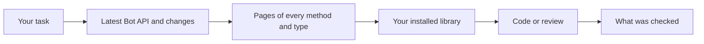

<div align="center">

# Telegram Bot Development

**A Claude Code skill that checks the live Telegram Bot API and your installed library before your AI agent writes bot code.**

[](https://github.com/nyxandro/telegram-bot-development-skill/releases)
[](LICENSE)
[](https://agentskills.io/specification)
[](#install)

**English** · [Русский](README.ru.md)

</div>

Build, review and debug Telegram bots and Mini Apps with Claude Code, Codex, OpenCode, Cursor or
any other agent that reads Agent Skills. The skill works with any language and framework, from
grammY, Telegraf, aiogram, python-telegram-bot and GramIO to Go, Rust, PHP and .NET libraries or
raw HTTPS. The official docs decide what exists. The library installed in your project decides
what your code can call.

## Why

The Bot API ships a release about once a month, and a release can undo what the previous one
added. In July 2026 Bot API 10.2 added `receiver_user_id` to `sendMessage`. Six weeks later 10.3
replaced it with `ephemeral_message_parameters`. An agent that learned the API before August will
confidently write code with a parameter that is already gone.

Writing from memory goes wrong in three ways.

- The agent calls parameters and methods that no longer exist.
- It builds workarounds for things the API now does natively.
- It quotes limits and fees from a year ago.

This skill makes the agent read the current docs and search your installed library before it
writes, reviews or recommends any Bot API call.

## Install

| Agent | Command |
|---|---|
| Claude Code, as a plugin | `/plugin install telegram-bot-development --marketplace nyxandro/skills` |
| Claude Code, Codex, OpenCode, Cursor and others | `npx skills add nyxandro/telegram-bot-development-skill` |
| Any agent, by hand | Download the [latest `.skill` archive](https://github.com/nyxandro/telegram-bot-development-skill/releases/latest/download/telegram-bot-development.skill) and unpack it into the agent's skills folder |

Pick one. If you install it two ways, Claude Code loads the skill twice.

<details>
<summary>More install options and requirements</summary>

<br>

- The one-line plugin install needs Claude Code 2.1.275 or later. On an older version, add the
  catalog first with `/plugin marketplace add nyxandro/skills` and then run
  `/plugin install telegram-bot-development@nyxandro`.
- The catalog pins no version, so every commit here reaches plugin users as an update. Run
  `claude plugin marketplace update nyxandro` and
  `claude plugin update telegram-bot-development@nyxandro`, or turn on auto-update under
  `/plugin` → Marketplaces.
- With `npx skills`, add `-g` to install the skill for every project. To install a given version,
  add its tag, as in `nyxandro/telegram-bot-development-skill@v1.0.0`.
- You can also clone this repository and link the `telegram-bot-development/` folder into your
  agent's skills folder. There is no build step.
- The scripts need Python 3.8 or newer and access to core.telegram.org and telegram.org. On
  Windows the interpreter is usually `py -3` or `python`. On macOS with Python from python.org,
  run `Install Certificates.command` once, or HTTPS requests fail. Without Python the agent reads
  the same official pages as plain URLs.
- Tested on Linux and Windows.

</details>

## Usage

Talk about your bot as usual. The skill starts whenever code, a question or a plan touches a
Telegram bot, the Bot API, BotFather or a Mini App, even for a small change like a new button.

- *My aiogram 3 bot answers through an LLM and takes about 20 seconds. Show the answer as it's
  generated and add a Stop button.*
- *In a group, show the rules only to the member who pressed the Rules button. Can our grammY
  version even do that?*
- *Review my webhook for reliability and security before launch.*
- *We sell a subscription for Telegram Stars. What do we turn on in BotFather, and what will it
  cost us?*

## How it works



1. The agent finds the current Bot API version and reads every change since the version your
   library declares.
2. It reads the official page of every method and type it touches, and the history of any name it
   isn't sure is still alive.
3. It checks that your installed library accepts that parameter on that exact method. A name that
   merely appears somewhere in the library doesn't count, and neither does an old parameter the
   library still accepts as deprecated.
4. Before it says "Telegram can't do that", it reads the features page and searches the docs.
5. It ends by saying what it checked, the Bot API version and date, and whether your library
   supports what it used.

## Example

This is real output of the skill's docs script, shortened. It's what the agent sees before it
writes a single `sendMessage` call.

```text
$ python3 scripts/tgdocs.py history receiver_user_id
10.3 (August 24, 2026): Added the class EphemeralMessageParameters and replaced the parameters
  receiver_user_id and callback_query_id in sendMessage, sendPhoto, sendVideo ... with the
  parameter ephemeral_message_parameters.
10.2 (July 14, 2026): Added the parameters receiver_user_id and callback_query_id to sendMessage,
  sendPhoto, sendVideo ...
```

Then it checks your project with `find_method_support.py sendMessage.ephemeral_message_parameters`
and writes code only with what both the docs and your library support.

## What it covers

Eleven references load only when a task needs them.

| Topic | When the agent reads it |
|---|---|
| Staying current | Any method call, a "this doesn't exist" report, a library that lags behind the API |
| Receiving updates | Polling or webhooks, deploys, scaling, shutdown, duplicate or lost updates |
| Conversations | `/start`, menus, keyboards, callbacks, commands, formatting, long text, deep links, groups and topics |
| Security and privacy | The token, the webhook secret, sign-in, permissions, user data, the privacy policy, abuse |
| Limits and performance | Broadcasts, bursts, 429 errors, files, throughput |
| Errors and edge cases | Error handling, retries, flaky behaviour, odd updates |
| Product features | What a bot can do today, product options, BotFather settings |
| Stars payments | Selling, subscriptions, refunds, payment disputes |
| Mini Apps | Launch, sign-in, theme, buttons, storage |
| AI bots | Streaming answers, formatting model output, threads, bot-to-bot, guest mode |
| Review checklist | A review or audit before release |

The developer terms are read clause by clause, including the fee on Stars purchases in bots that
enable topics in private chats.

## Tools

Two scripts, Python 3.8 or newer, standard library only. Pages are cached for six hours in
`~/.cache/telegram-bot-docs`.

| Script | What it does |
|---|---|
| `scripts/tgdocs.py` | The official docs in their Markdown form. The latest version, changes since a version, a method or type page, search, the history of a name, any guide and the developer terms |
| `scripts/find_method_support.py` | Finds the Telegram libraries installed in a project and shows whether each one knows a method, a type or a `METHOD.PARAMETER`, with the matching lines |

## Versions

The current version sits in `metadata.version` of `telegram-bot-development/SKILL.md`, so any
installed copy tells you which one it is. Every version has a git tag and a
[release](https://github.com/nyxandro/telegram-bot-development-skill/releases) with its own
archive. [CHANGELOG.md](CHANGELOG.md) lists what changed.

<details>
<summary>Tests</summary>

<br>

```bash
uv run --with pytest --with hypothesis python -m pytest test
```

The tests run offline. Small fake pages and packages stand in for the docs and the libraries.
pytest and Hypothesis are needed only for the tests, not by the skill.

`telegram-bot-development/evals/` holds test tasks for the agent, their assertions and the results
of past runs. Its README describes the fixtures. The folder is left out of the archive.

</details>

<details>
<summary>Repository layout</summary>

<br>

```text
telegram-bot-development/             the skill
  SKILL.md                            the workflow, live API and installed library first
  references/                         eleven references, read only when a task needs them
  scripts/tgdocs.py                   the official docs, live
  scripts/find_method_support.py      what the project's installed library knows
  evals/                              test tasks for the agent and their results, not in the archive
test/                                 offline tests of both scripts
dist/telegram-bot-development.skill   the skill folder as a downloadable archive
CHANGELOG.md                          what changed in each version
README.md, README.ru.md               this page in English and in Russian
```

</details>

## License

[MIT](LICENSE)
