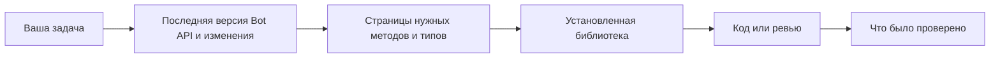

<div align="center">

# Telegram Bot Development

**Скилл для Claude Code, который сверяется с живым Telegram Bot API и с библиотекой в вашем проекте, прежде чем ИИ-агент напишет код бота.**

[](https://github.com/nyxandro/telegram-bot-development-skill/releases)
[](LICENSE)
[](https://agentskills.io/specification)
[](#установка)

[English](README.md) · **Русский**

</div>

Разработка, ревью и отладка Telegram-ботов и Mini Apps в Claude Code, Codex, OpenCode, Cursor и
любом другом агенте, который понимает Agent Skills. Скилл работает с любым языком и фреймворком.
Это может быть grammY, Telegraf, aiogram, python-telegram-bot, GramIO, библиотеки на Go, Rust, PHP
и .NET или голый HTTPS. Что вообще существует, решает официальная документация. Что может вызвать
ваш код, решает библиотека, установленная в проекте.

## Зачем

Новая версия Bot API выходит примерно раз в месяц, и она может отменить то, что добавила
предыдущая. В июле 2026 года Bot API 10.2 добавил в `sendMessage` параметр `receiver_user_id`.
Через шесть недель версия 10.3 заменила его на `ephemeral_message_parameters`. Агент, который
выучил API до августа, уверенно напишет код с параметром, которого уже нет.

Код по памяти ломается тремя способами.

- Агент вызывает параметры и методы, которых больше нет.
- Строит обходные пути там, где API теперь умеет это сам.
- Называет лимиты и комиссии годичной давности.

Скилл заставляет агента прочитать актуальную документацию и проверить установленную библиотеку,
прежде чем писать, проверять или советовать любой вызов Bot API.

## Установка

| Агент | Команда |
|---|---|
| Claude Code, как плагин | `/plugin install telegram-bot-development --marketplace nyxandro/skills` |
| Claude Code, Codex, OpenCode, Cursor и другие | `npx skills add nyxandro/telegram-bot-development-skill` |
| Любой агент, вручную | Скачайте [архив `.skill` последнего выпуска](https://github.com/nyxandro/telegram-bot-development-skill/releases/latest/download/telegram-bot-development.skill) и распакуйте в папку скиллов агента |

Выберите один способ. Если поставить двумя, Claude Code загрузит скилл дважды.

<details>
<summary>Другие способы установки и требования</summary>

<br>

- Установка плагина одной командой работает в Claude Code 2.1.275 и новее. На старой версии
  сначала добавьте каталог командой `/plugin marketplace add nyxandro/skills`, потом выполните
  `/plugin install telegram-bot-development@nyxandro`.
- Версия в каталоге не закреплена, поэтому каждый коммит сюда приходит пользователям плагина как
  обновление. Выполните `claude plugin marketplace update nyxandro` и
  `claude plugin update telegram-bot-development@nyxandro` или включите автообновление в
  `/plugin` → Marketplaces.
- С `npx skills` добавьте `-g`, чтобы скилл стоял во всех проектах. Чтобы поставить определённую
  версию, допишите её метку, например `nyxandro/telegram-bot-development-skill@v1.0.0`.
- Можно и клонировать репозиторий, а в папку скиллов агента положить ссылку на папку
  `telegram-bot-development/`. Сборка не нужна.
- Скриптам нужен Python 3.8 или новее и доступ к core.telegram.org и telegram.org. В Windows
  интерпретатор обычно называется `py -3` или `python`. На macOS с Python с python.org один раз
  запустите `Install Certificates.command`, иначе HTTPS-запросы падают. Без Python агент читает те
  же официальные страницы по обычным ссылкам.
- Проверено на Linux и Windows.

</details>

## Как пользоваться

Говорите о боте как обычно. Скилл включается, когда код, вопрос или план касается Telegram-бота,
Bot API, BotFather или Mini App, даже если это мелочь вроде новой кнопки.

- *Бот на aiogram 3 отвечает через LLM, ответ генерируется секунд 20. Хочу, чтобы ответ было видно
  по мере генерации и его можно было остановить кнопкой.*
- *В группе нужно показывать правила только тому, кто нажал кнопку "Правила". Наша версия grammY
  это вообще умеет?*
- *Проверь мой вебхук на надёжность и безопасность перед запуском.*
- *Продаём подписку за Telegram Stars. Что включить в BotFather и во что это нам обойдётся?*

## Как работает



1. Агент находит текущую версию Bot API и читает все изменения после той версии, которую
   объявляет ваша библиотека.
2. Читает официальную страницу каждого метода и типа, которого касается, и историю любого имени,
   в котором не уверен.
3. Проверяет, что ваша библиотека принимает этот параметр именно в этом методе. Имя, которое
   просто встречается где-то в библиотеке, не считается. Старый параметр, который библиотека ещё
   принимает как устаревший, тоже.
4. Прежде чем сказать "Telegram так не умеет", читает страницу возможностей и ищет по документации.
5. В конце говорит, что проверил, версию Bot API с датой и поддерживает ли ваша библиотека то, что
   он использовал.

## Пример

Это настоящий вывод скрипта документации из скилла, сокращённый. Его агент видит до того, как
напишет хоть один вызов `sendMessage`.

```text
$ python3 scripts/tgdocs.py history receiver_user_id
10.3 (August 24, 2026): Added the class EphemeralMessageParameters and replaced the parameters
  receiver_user_id and callback_query_id in sendMessage, sendPhoto, sendVideo ... with the
  parameter ephemeral_message_parameters.
10.2 (July 14, 2026): Added the parameters receiver_user_id and callback_query_id to sendMessage,
  sendPhoto, sendVideo ...
```

Потом агент проверяет проект командой
`find_method_support.py sendMessage.ephemeral_message_parameters` и пишет код только с тем, что
поддерживают и документация, и ваша библиотека.

## Что покрывает

Одиннадцать справочных файлов агент открывает, только когда они нужны задаче.

| Тема | Когда агент её читает |
|---|---|
| Актуальность API | Любой вызов метода, жалоба "этого нет", библиотека отстаёт от API |
| Получение обновлений | Polling или вебхуки, деплой, масштабирование, остановка, дубли и потерянные обновления |
| Диалог с пользователем | `/start`, меню, клавиатуры, колбэки, команды, форматирование, длинный текст, deep links, группы и темы |
| Безопасность и данные | Токен, секрет вебхука, вход, права, данные пользователей, политика конфиденциальности, злоупотребления |
| Лимиты и производительность | Рассылки, всплески, ошибки 429, файлы, пропускная способность |
| Ошибки и крайние случаи | Обработка ошибок, повторы, нестабильное поведение, странные обновления |
| Возможности бота | Что бот умеет сегодня, продуктовые опции, настройки BotFather |
| Оплата звёздами | Продажи, подписки, возвраты, спорные платежи |
| Mini Apps | Запуск, вход, тема, кнопки, хранилище |
| ИИ-боты | Ответ по мере генерации, форматирование ответов модели, треды, бот-бот, гостевой режим |
| Чек-лист ревью | Проверка или аудит перед выпуском |

Условия для разработчиков агент читает по пунктам, включая комиссию с покупок за звёзды в ботах,
где включены темы в личных чатах.

## Инструменты

Два скрипта на Python 3.8 или новее, только стандартная библиотека. Страницы кэшируются на шесть
часов в `~/.cache/telegram-bot-docs`.

| Скрипт | Что делает |
|---|---|
| `scripts/tgdocs.py` | Официальная документация в виде Markdown. Последняя версия, изменения после версии, страница метода или типа, поиск, история имени, любое руководство и условия для разработчиков |
| `scripts/find_method_support.py` | Находит Telegram-библиотеки, установленные в проекте, и показывает, знает ли каждая метод, тип или `METHOD.PARAMETER`, с найденными строками |

## Версии

Текущая версия записана в поле `metadata.version` файла `telegram-bot-development/SKILL.md`, так
что любая установленная копия показывает, какая она. У каждой версии есть метка в git и
[выпуск](https://github.com/nyxandro/telegram-bot-development-skill/releases) со своим архивом.
[CHANGELOG.md](CHANGELOG.md) рассказывает, что изменилось.

<details>
<summary>Тесты</summary>

<br>

```bash
uv run --with pytest --with hypothesis python -m pytest test
```

Тесты работают без сети. Вместо документации и библиотек подставляются маленькие поддельные
страницы и пакеты. pytest и Hypothesis нужны только для тестов, самому скиллу они не нужны.

В `telegram-bot-development/evals/` лежат тестовые задачи для агента, их проверки и результаты
прошлых прогонов. Подготовленные файлы описаны в README этой папки. В архив скилла папка не
входит.

</details>

<details>
<summary>Устройство репозитория</summary>

<br>

```text
telegram-bot-development/             сам скилл
  SKILL.md                            порядок работы, сначала живой API и установленная библиотека
  references/                         одиннадцать справочных файлов, только когда нужны задаче
  scripts/tgdocs.py                   официальная документация, вживую
  scripts/find_method_support.py      что знает установленная в проекте библиотека
  evals/                              тестовые задачи для агента и результаты, не в архиве
test/                                 тесты обоих скриптов без сети
dist/telegram-bot-development.skill   папка скилла архивом для скачивания
CHANGELOG.md                          что изменилось в каждой версии
README.md, README.ru.md               эта страница на английском и на русском
```

</details>

## Лицензия

[MIT](LICENSE)
